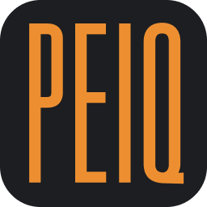
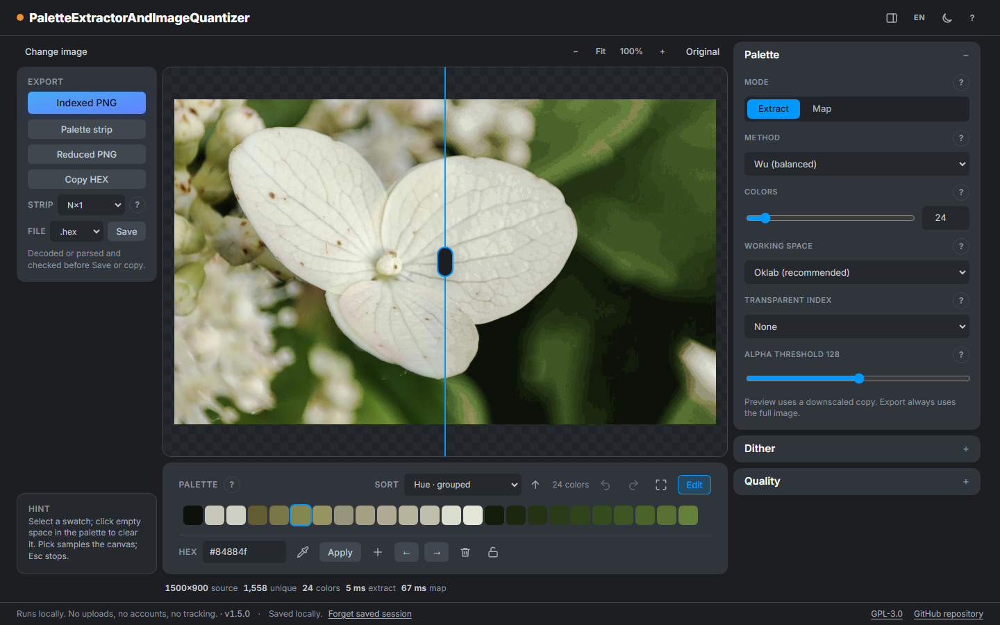
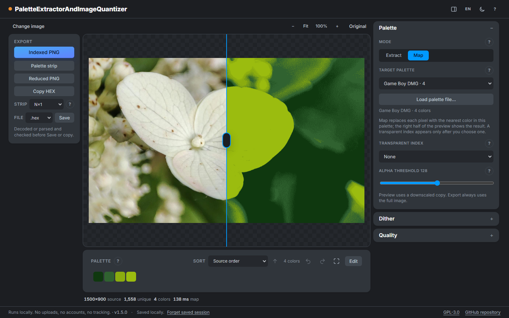

<p align="center"></p>

<h1 align="center">PaletteExtractorAndImageQuantizer</h1>

<p align="center"><strong>PEIQ</strong> · browser-local palette compiler</p>

<p align="center">Extract 2–256 colors from any image, map it to built-in or imported palettes, dither, and export validated indexed PNGs, palette strips, reduced PNGs, and .hex/.gpl/.json files. Runs entirely in browser.</p>

<p align="center">
  <a href="https://kirillhod.github.io/PaletteExtractorAndImageQuantizer/"><strong>Open the app</strong></a> ·
  <a href="#quick-start">Quick start</a> ·
  <a href="https://github.com/kirillhod/PaletteExtractorAndImageQuantizer/releases">Releases</a> ·
  <a href="https://github.com/kirillhod/PaletteExtractorAndImageQuantizer/issues">Issues</a>
</p>

<p align="center"></p>

## At a glance

| Capability | What it does |
|:--|:--|
| **Input** | PNG, JPEG, WebP, GIF, BMP, AVIF · up to 16.7 MP |
| **Extract** | 2–256 colors · five algorithms · Oklab or sRGB |
| **Map** | Built-in or imported palettes · nearest color |
| **Dither** | Error diffusion · Bayer 2/4/8 · blue noise |
| **Check** | CIEDE2000 metrics · error map · 20 worst pixels |
| **Export** | Indexed PNG · palette strip · reduced PNG · HEX/GPL/JSON |

## How it works

1. **Drop** an image or paste it from the clipboard.
2. **Extract** a palette, or choose a built-in or imported one.
3. **Dither** and compare the result with the original.
4. **Export** a validated indexed PNG, palette strip, reduced PNG, or palette file.

> The original half always draws the full-resolution image. Mapping uses the full image up to
> 4,194,304 pixels and scales larger images to that budget for the preview; the status line
> names the preview size when it differs. Export always processes the original at full resolution.

## In detail

<details>
<summary><strong>Extract</strong> · five algorithms, eight sort orders, full editor</summary>

- **Algorithms:** popularity, median cut, Wu (default), octree, K-means++.
- **Range:** 2–256 colors, set with a slider or typed as an exact number.
- **Space:** Oklab (default) or sRGB. Median cut and Wu run a Lloyd refinement pass after the initial split.
- **Order:** source, manual, hue grouped, hue perceptual, lightness, perceptual smooth, perceptual color path, perceptual flow. The direction button reverses hue grouped, hue perceptual, and lightness.
- **Editor:** change a HEX value, copy it from the button beside the field, add or remove entries, lock entries, and move colors with <kbd>←</kbd>/<kbd>→</kbd> or by dragging a swatch in Edit mode. A move cannot cross a locked entry.
- **Preview and picks:** full-screen strip with a gap between colors on a switchable neutral background, or any color that is remembered. HEX/RGB captions copy on click. Pick colors on the canvas; each sampled color gets a draggable anchor.
- **Compare and undo:** draggable divider between original and result; undo and redo cover palette and settings changes.

Reordering changes the exported index order. The preview and reduced PNG keep the same pixels because the color set is unchanged, apart from exact ties; adding, removing, or editing a color changes the mapping.

</details>

<details>
<summary><strong>Map</strong> · built-in or imported palettes, transparent index</summary>

| Built-in palette | Colors |
|:--|--:|
| PICO-8 | 16 |
| Game Boy DMG | 4 |
| Commodore 64 (VICE) | 16 |
| ZX Spectrum | 15 |
| EGA | 16 |

- **Import:** `.hex`, `.gpl`, `.pal`, `.json`, or a PNG palette strip (`N×1` or `1×N`), up to 256 colors.
- **Mapping:** every pixel becomes the nearest color in the target palette. Method, color count, and working space apply in Extract mode only.
- **Transparent index:** starts at **None**, so every palette color stays visible. If the image has transparency, indexed export reserves the least-used entry automatically and names it in the result. Pixels mapped to the chosen index become transparent in the preview and in indexed and strip output.
- **Alpha threshold:** set it and see the result immediately.

</details>

<details>
<summary><strong>Dither</strong> · error diffusion, ordered, blue noise</summary>

- **Error diffusion:** Floyd–Steinberg, Atkinson, Stucki, Jarvis, Burkes, Sierra.
- **Ordered:** Bayer 2×2, 4×4, and 8×8.
- **Blue noise:** a generated 64×64 void-and-cluster mask.
- **Controls:** strength, serpentine scan, and edge stop; the last two apply to error diffusion only.

<p align="center"></p>

<p align="center"><sub>Game Boy DMG, Floyd–Steinberg, strength 80%, serpentine, edge stop 50%.</sub></p>

</details>

<details>
<summary><strong>Check</strong> · CIEDE2000 metrics and error map</summary>

- **Metrics:** CIEDE2000 mean, p95, and max between the source and the mapped preview.
- **Error map:** toggle the right half between the mapped result and a CIEDE2000 map, from near-zero (dark blue) to 20+ (red). It stays on across settings and palette changes and re-measures the new preview automatically.
- **Worst pixels:** the 20 worst entries with coordinates, located by numbered markers on the error map.

Measurements use the preview; fully transparent pixels are skipped.

</details>

<details>
<summary><strong>Export</strong> · validated files, smallest bit depth</summary>

| Format | Details |
|:--|:--|
| **Indexed PNG** | `PLTE` and optional `tRNS`, at the smallest bit depth (1, 2, 4, or 8 bits) |
| **Palette strip** | Exact `N×1` or `1×N` PNG |
| **Reduced PNG** | RGBA for previews and sharing |
| **Palette files** | `.hex`, `.gpl`, or `.json`; the HEX list also copies to the clipboard |

Every export is decoded or parsed again and compared before the Save link appears; a mismatch blocks the download. PNG output is compressed losslessly: file size drops, the pixels and palette do not change. **Save** and **Copy** work on every validated result; PNGs copy as images where the browser allows it, palette files as text.

</details>

<details>
<summary><strong>Interface and session</strong> · canvas, URL state, IndexedDB</summary>

- **Canvas:** fit, 100%, zoom buttons, wheel and pinch zoom from 2% to 6400%, pan, an original toggle, and a keyboard-operable divider. **Full screen** lifts the canvas over the window and **Hide canvas** gives its space to the palette; <kbd>Esc</kbd> returns.
- **URL state:** mode, extractor, colors, working space, dither, alpha threshold, transparent index, sort, and target palette live in the hash. A reload restores them; the image is never in the URL.
- **Session:** the last image, palette edits, settings, locks, selection, picked-color markers, and undo/redo history restore from IndexedDB. **Forget saved session** in the footer removes them after a confirmation.
- **Themes and help:** dark, light, and automatic themes; a Help drawer with extraction and mapping guides, keyboard shortcuts, and references; `?` explainers on most settings.

</details>

## Privacy

- **Images:** decoded and processed entirely in your browser.
- **Network:** no requests after the page loads.
- **Tracking:** no analytics, accounts, cookies, or third-party scripts.
- **Storage:** theme, language, and layout preferences in local storage; the optional saved session in IndexedDB.

## Browser support

| Browser | Minimum |
|:--|--:|
| Chrome / Edge | 111+ |
| Firefox | 113+ |
| Safari | 16.4+ |

Needs ES modules, Web Workers, Canvas 2D, `createImageBitmap`, `CompressionStream` / `DecompressionStream`, and `crypto.subtle`. No extensions or WebAssembly.

## Quick start

Use the [hosted app](https://kirillhod.github.io/PaletteExtractorAndImageQuantizer/), or serve the folder locally:

```bash
npm run dev
```

Then open `http://localhost:5173/`. No install or build step; Node.js 22+ runs the development server.

<details>
<summary><strong>Credits and license</strong></summary>

- **Inter font:** self-hosted under the SIL Open Font License 1.1; the license ships as [assets/fonts/OFL.txt](assets/fonts/OFL.txt).
- **Algorithms:** original implementations of published methods. The Help drawer's **References** section links the papers for extraction, dithering, CIEDE2000, Oklab, PNG, sRGB, and WCAG.
- **Built-in palettes:** factual hardware and community color values. Names and trademarks belong to their owners; this project is not affiliated with them.
- **Blue-noise mask:** generated locally by `tools/gen-blue-noise.mjs`.

</details>

---

<p align="center"><sub><strong>License:</strong> GPL-3.0-only · <a href="LICENSE">LICENSE</a></sub></p>
