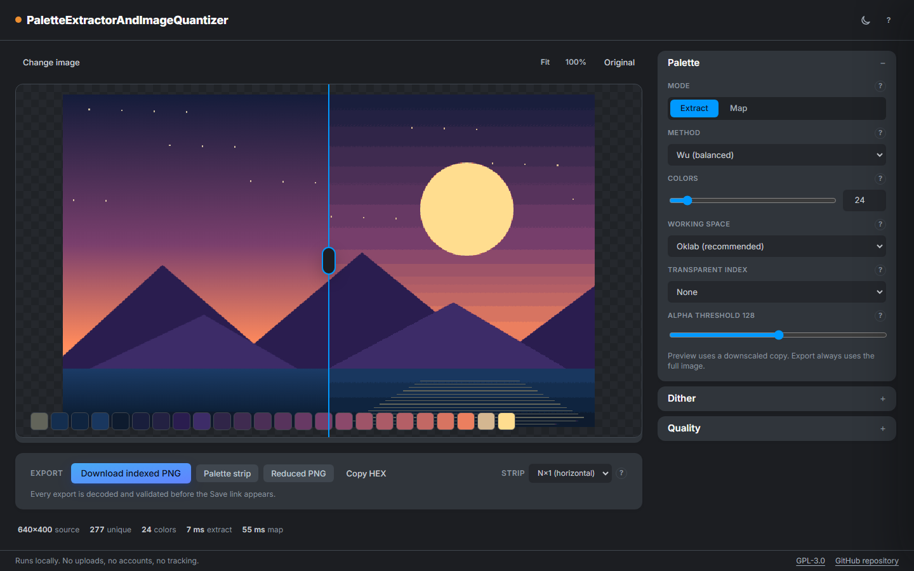
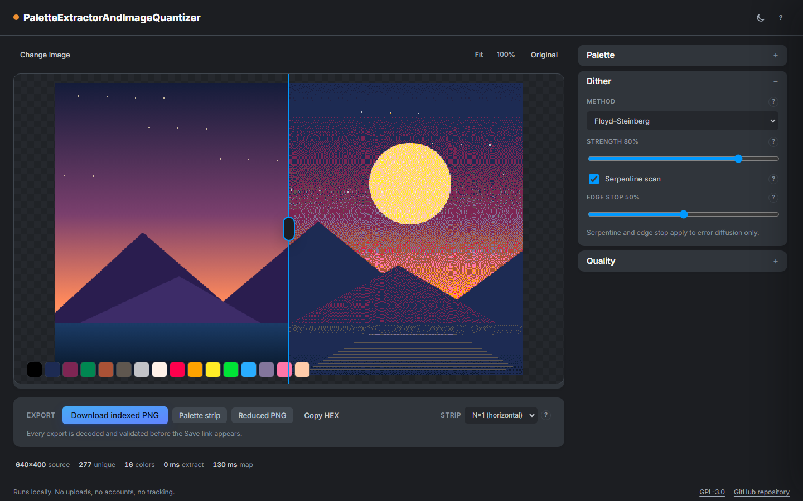

# PaletteExtractorAndImageQuantizer

**Turn any image into a clean, usable palette — right in your browser.**

Extract colors, map an image to a fixed palette, dither the result, and export
engine-ready indexed PNGs and palette strips. Everything runs on your device: no uploads,
no accounts, no dependencies, no build step.



*Extract up to 256 colors, compare before and after, and export a validated indexed PNG.*

## What you can do

### Extract a palette

Choose the colors that define your image.

- Five extractors: **popularity**, **median cut**, **Wu**, **octree**, and **K-means++**.
- From **2 to 256 colors**, with a slider or an exact number.
- Work in **Oklab** for perceptual results or **sRGB** for legacy pipelines.
- Median cut and Wu get a Lloyd refinement pass for cleaner clusters.
- Sort the result by source order, hue, or lightness — both directions.
- See the original and the reduced image side by side with a draggable divider.

### Map to a fixed palette

Constrain artwork to the palette your engine or hardware expects.

- Built-in palettes: **PICO-8**, **Game Boy DMG**, **Commodore 64**, **ZX Spectrum**, and
  **EGA**.
- Import `.hex`, `.gpl`, `.pal`, `.json`, or a PNG palette strip (`N×1` or `1×N`).
- Choose a transparent index for sprites.
- Tune the alpha threshold and preview the result immediately.

### Dither like a pixel artist

- **Error diffusion:** Floyd–Steinberg, Atkinson, Stucki, Jarvis, Burkes, Sierra.
- **Ordered:** Bayer 2×2, 4×4, and 8×8.
- **Blue noise:** a generated 64×64 void-and-cluster mask.
- Adjust strength, serpentine scan, and edge stop.
- Hover or tap the `?` next to any setting for a short explanation.



*Map to a built-in palette and tune error diffusion until the result looks right.*

### Export files your tools can use

- **Indexed PNG** with `PLTE` and optional `tRNS`, using the smallest bit depth for the
  palette (1, 2, 4, or 8 bits).
- **Palette strip** as an exact `N×1` or `1×N` PNG.
- **Reduced RGBA PNG** for quick previews and sharing.
- **HEX list** copied to the clipboard.

Every export is decoded again and compared with the expected pixel data before the Save
link appears. If something does not match, the download is blocked.

### Work comfortably

- Dark, light, and automatic themes.
- Before/after divider, fit, 100% zoom, and original toggle.
- Helpful tooltips and a Help drawer with a reference list.
- Keyboard shortcuts: `F` fit, `1` 100%, `O` original, `T` theme, `?` Help.
- Everything stays responsive down to phone width.

## How it works

1. **Drop an image** or paste it from the clipboard.
2. **Extract** a palette or pick a fixed one.
3. **Dither** if you want to trade sharp dots for smoother gradients.
4. **Export** an indexed PNG, a palette strip, or a reduced image.

The preview uses a downscaled copy for speed. Export always processes the original image
at full resolution.

## Built-in palettes

| Palette | Colors |
|---|---:|
| PICO-8 | 16 |
| Game Boy DMG | 4 |
| Commodore 64 (VICE) | 16 |
| ZX Spectrum | 15 |
| EGA | 16 |

You can also import any palette with up to 256 colors.

## Privacy

Images are decoded and processed entirely in your browser. Nothing is uploaded, and the
page makes no network requests after loading. No analytics, accounts, cookies, or
third-party scripts.

## Browser support

Current Chrome, Edge, Firefox, and Safari. The app needs ES modules, Web Workers, canvas,
and `createImageBitmap`; no extensions or WebAssembly are required.

## Run it locally

The app is a static page with no install or build step. Serve the folder and open it in a
browser:

```bash
npm run dev
```

Then open `http://localhost:5173/`.

## Credits

- **Code:** original work, GPL-3.0-only. See [LICENSE](LICENSE).
- **Inter font:** self-hosted under the SIL Open Font License 1.1. The license ships as
  [assets/fonts/OFL.txt](assets/fonts/OFL.txt).
- **Algorithms:** implementations are original and follow the published methods. The
  Help drawer’s **References** section links the papers for the extractors, dithering,
  CIEDE2000, Oklab, PNG, sRGB, and WCAG.
- **Built-in palettes:** factual hardware and community color values. Names and
  trademarks belong to their owners; this project is not affiliated with them.
- **Blue-noise mask:** generated locally by `tools/gen-blue-noise.mjs`.

**License:** GPL-3.0-only. See [LICENSE](LICENSE).
